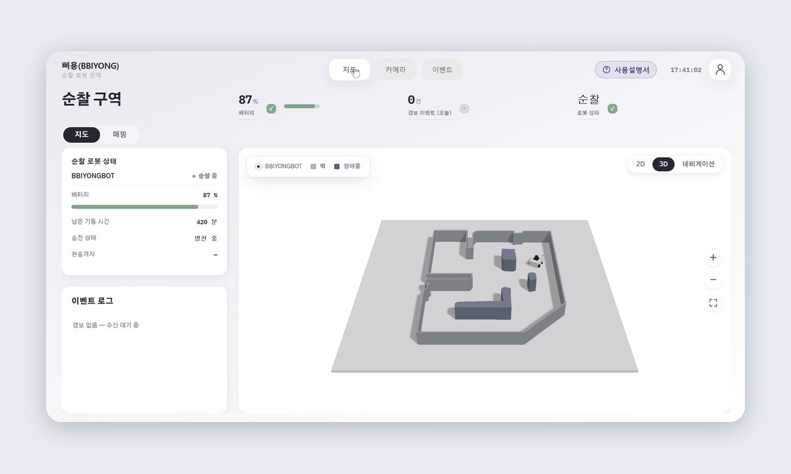
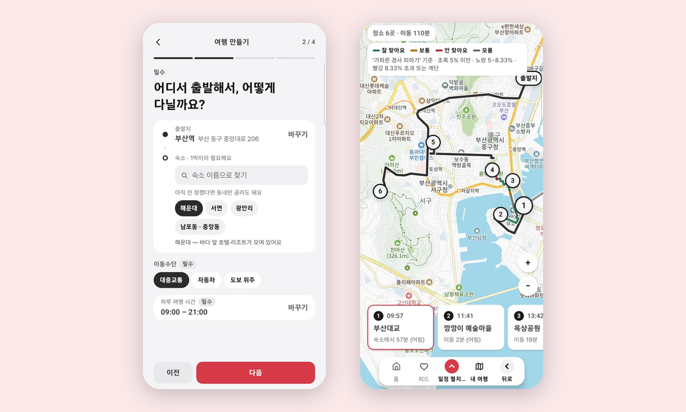
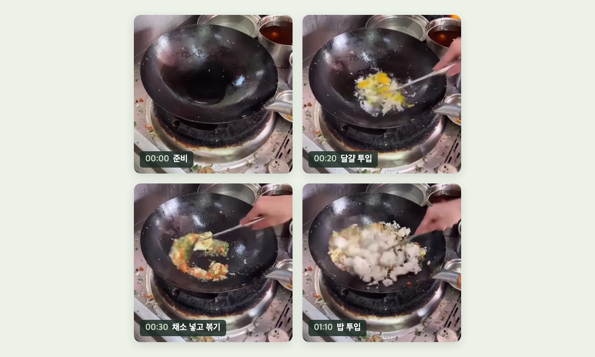
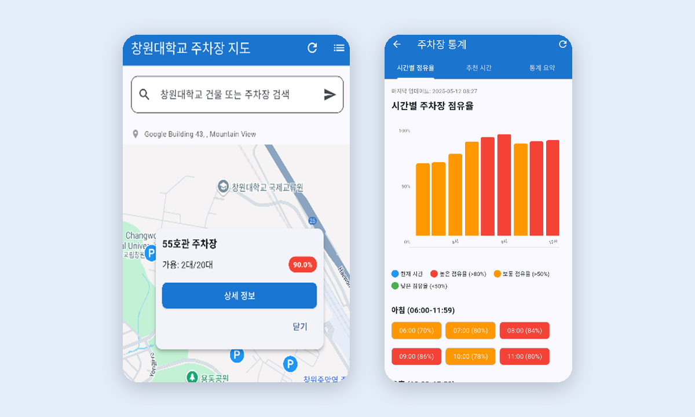

### 안녕하세요, 백엔드 개발자 모진성입니다 👋

Java와 Spring Boot로 백엔드를 개발하고 있습니다. 
SSAFY에서 로봇 관제 서버와 여행 일정 서비스를 만들면서 중복 요청이나 동시 수정 같은 데이터 문제를 많이 다뤘습니다. 
지금은 로보터블 기업연계 프로젝트에서 요리 영상을 행동별 구간으로 나누는 방법론을 찾고 있습니다. 
팀 프로젝트에서는 각자 만든 코드가 하나로 잘 맞물리도록 작업 규칙을 먼저 맞추고, 막힌 연결 지점을 풀어 팀원들이 계속 개발할 수 있게 하는 일을 중요하게 생각합니다.

- 🎓 컴퓨터공학 전공 · SSAFY 15기 Java 과정 · 정보처리기사
- 🔗 [포트폴리오](https://jinsung-mo.github.io/) · [ahwlstjd57@gmail.com](mailto:ahwlstjd57@gmail.com)

 

### 프로젝트

<table>
<tr>
<td width="50%" valign="top">

**[삐용](https://github.com/jinsung-mo/-BBIYONG-autonomous_driving_factory_patrol_robot)** · 공장 순찰 로봇 관제 시스템 
2026.07 ~ 08 · 6인 팀 · 팀장

공장을 자율 순찰하는 로봇의 위치, 영상, 화재 경보를 웹에서 보고 원격으로 조종하는 시스템입니다.

**맡은 역할** 팀장, Spring Boot 관제 서버, 로봇·웹 실시간 통신, 경보 저장, 릴리스 통합

🏆 SSAFY 공통프로젝트 우수상
</td>
<td width="50%" valign="top">

**[가볼래](https://github.com/jinsung-mo/gabolle-busan-travel)** · 외국인 여행객용 부산 여행 일정 앱 
2026.08 ~ 진행 중 · 6인 팀

외국인 여행객이 취향과 이동 조건에 맞춰 부산 여행 일정을 만드는 앱입니다. SSAFY 기간이 끝난 뒤에도 팀이 앱 업데이트를 이어 가고 있습니다.

**맡은 역할** 여행·일정 API, PostgreSQL 저장과 검증, 이벤트 저장 경로 수정

🏆 SSAFY 특화프로젝트 우수상 
🎪 FLY ASIA 2026 전시
</td>
</tr>
<tr>
<td width="50%" valign="top">

**[로보터블 기업연계](https://lab.ssafy.com/s15-final/S15P31E109)** · 요리 영상 구간 분할 
2026.10 ~ 진행 중 · 6인 팀 
SSAFY GitLab 비공개 저장소(로그인 필요) · 외부에서는 [포트폴리오](https://jinsung-mo.github.io/#robotable)에서 볼 수 있습니다

고정 화각 요리 영상을 행동별 구간으로 나누면서, VLM 토큰 사용량을 줄이는 방법론을 찾는 프로젝트입니다. 이후 요리 영상을 레시피, 숏츠, 블로그 글로 만들어 주는 B2C 앱을 구상하고 있습니다.

**맡은 역할** S1(예상 구간 추출) 논문 방법 비교, VLM 입력 방식 실험, 사람 정답 기준 검증

🤝 로보터블 × SSAFY 기업연계 프로젝트
</td>
<td width="50%" valign="top">

**[빈자리](https://github.com/jinsung-mo/Smart-Parking-Lot-Monitoring-Service_BINJAIR)** · 주차장 빈자리 안내 앱 
2024.12 ~ 2025.06 · 2인 팀 · 캡스톤 디자인

주차면마다 센서를 다는 대신, 주차장 카메라 영상만으로 빈자리를 찾아 앱에 보여 주는 서비스입니다.

**맡은 역할** Flask 영상 분석 서버, 주차면 상태 판정, 상태 API

🏆 교내 소프트웨어 전시회 인기상
</td>
</tr>
</table>

 

### 해결한 문제와 트러블슈팅

제목을 누르면 문제, 원인, 해결, 결과 순서로 볼 수 있습니다.

<b>같은 경보가 여러 번 저장될 수 있던 문제</b> · 삐용

 

**문제** 무선 환경에서는 로봇이 같은 화재 경보를 다시 보낼 수 있어, 같은 경보가 여러 번 저장될 수 있었습니다. 
**원인** 경보 식별자(`messageId`)로 먼저 확인해도, 같은 경보가 동시에 들어오면 확인과 저장 사이에서 둘 다 통과할 수 있었습니다. 
**해결** `messageId`로 먼저 확인하고, 그 사이에 겹치는 요청은 MySQL UNIQUE 제약으로 막았습니다. 
**결과** 같은 경보 100건을 32개 스레드로 동시에 저장하는 테스트에서 1건만 남는 것을 확인했습니다(프로젝트 종료 후 추가).

[검증 기록 보기](https://github.com/jinsung-mo/-BBIYONG-autonomous_driving_factory_patrol_robot/blob/main/docs/post-project/README.md)

<b>경보 통계 조회가 느리던 문제 (55.9ms → 4.9ms)</b> · 삐용

 

**문제** 최근 24시간 경보 통계 조회가 합성 이벤트 20만 건 기준 55.9ms 걸렸습니다. 
**원인** `event_logs`를 시간 범위로 조회하는데 인덱스가 없어, 약 19.9만 행을 전부 훑고 있었습니다. 
**해결** 시간 범위 인덱스와 로봇별 복합 인덱스를 추가했습니다. 
**결과** 검사 행이 6,642개로 줄어 4.9ms가 됐습니다. 실행 계획과 재현 SQL도 함께 남겼습니다(프로젝트 종료 후 개인 작업).

[측정 조건 보기](https://github.com/jinsung-mo/-BBIYONG-autonomous_driving_factory_patrol_robot/blob/main/docs/post-project/README.md#3-인덱스-측정-결과)

<b>로봇 연결 코드가 없어 다른 파트 개발이 막히던 문제</b> · 삐용 (팀장)

 

**문제** 로봇 쪽 연결 코드가 아직 없어 데이터가 들어오지 않았고, 다른 파트가 실제 데이터로 개발하기 어려웠습니다. 
**해결** `cloud_bridge.py`를 직접 작성해 로봇에서 웹까지 통신을 먼저 열었습니다. 팀장으로서 Jira 운영 규칙과 브랜치 전략을 먼저 정하고, 파트별 코드를 최종 릴리스로 통합했습니다. 
**결과** 다른 파트도 실제 데이터로 개발을 이어갈 수 있었고, 6명이 만든 코드를 하나의 릴리스로 합쳤습니다.

[프로젝트 보기](https://github.com/jinsung-mo/-BBIYONG-autonomous_driving_factory_patrol_robot)

<b>같은 요청이 동시에 오면 여행이 중복 생성되던 문제</b> · 가볼래

 

**문제** 응답을 못 받은 사용자가 여행 만들기를 다시 누르면, 같은 요청이 두 번 와서 여행이 두 개 생길 수 있었습니다. 
**원인** 요청 키가 있는지 조회한 뒤 저장해서, 동시에 들어온 두 요청이 모두 "키가 없다"고 판단했습니다. 
**해결** `Idempotency-Key`를 DB에 먼저 저장한 요청만 여행을 만들도록 순서를 바꿨습니다. 같은 키로 같은 내용이 오면 기존 여행을 돌려주고(200), 내용이 다르면 거절합니다(409). 
**결과** 같은 키로 8개 요청을 동시에 보내도 여행은 1개만 생깁니다.

[자세히 보기](https://github.com/jinsung-mo/gabolle-busan-travel#1-같은-요청이-동시에-오면-여행이-중복-생성되던-문제)

<b>두 사람이 동시에 고치면 앞사람의 변경이 지워지던 문제</b> · 가볼래

 

**문제** 동행자 두 명이 같은 일정을 보고 동시에 고치면, 나중에 저장한 사람이 앞사람의 변경을 덮어썼습니다. 
**원인** 저장 직전에 최신 버전을 읽어도, 읽기와 쓰기 사이에 다른 요청이 끼어들 수 있었습니다. 
**해결** 수정 요청에 사용자가 읽은 버전을 함께 받고, 일정 판 번호에 `UNIQUE (itinerary_id, version)` 제약을 걸어 같은 판이 두 번 저장되지 않게 했습니다. 충돌한 수정은 409로 돌려보내 최신 일정을 다시 받도록 했습니다. 
**결과** 8개 동시 수정 중 1건만 성공하는 테스트와, 실제 PostgreSQL에서 중복 판이 거절되는 통합 테스트를 작성했습니다.

[자세히 보기](https://github.com/jinsung-mo/gabolle-busan-travel#2-동행자-두-명이-동시에-고치면-앞사람의-변경이-지워지던-문제)

<b>VLM 판독 토큰이 너무 많이 들던 문제 (100% → 9.4%)</b> · 로보터블

 

**문제** 프레임을 사진으로 한 장씩 VLM에 보내면, 사람 검수 16편을 판독하는 데 344만 토큰이 들었습니다. 
**해결** 원본 시각을 새긴 480px 저해상도 영상 조각(0.5fps, 120초)으로 입력을 바꿨습니다. 
**결과** 판독 토큰은 팀 방식의 9.4%로 줄었고, 경계 F1(±5초)은 0.674에서 0.708로 떨어지지 않았습니다(팀 결정 전 제안).

[포트폴리오에서 보기](https://jinsung-mo.github.io/#robotable)

<b>AI 라벨로는 0.79였던 모델 점수가 사람 정답에서는 무작위 수준이던 문제</b> · 로보터블

 

**문제** AI 라벨로 학습하고 평가해 경계 F1 0.792가 나온 팀 모델을 사람이 검수한 16편에 그대로 적용하니 0.204였습니다. 같은 개수를 무작위로 찍은 값(0.196)과 다르지 않았습니다. 
**원인** AI 라벨은 손을 옮기는 순간까지 경계로 세서 분당 23.4개를 가르쳤고, 사람 정답은 분당 3.8개였습니다. 
**해결 제안** 학습 라벨의 경계 기준을 사람 쪽에 맞추는 일을 먼저 하자고 제안했습니다(팀 결정 전). 조리 단계 중심 규칙으로 다시 학습하자 0.204가 0.385로 올랐습니다.

[포트폴리오에서 보기](https://jinsung-mo.github.io/#robotable-case)

 

### 기술

**주로 쓰는 기술** 
 
Java · Spring Boot · Spring Data JPA · MySQL · PostgreSQL · Git · Jira

**프로젝트에서 써본 기술** 
 
Python · Flask · PyTorch · Gemini API · SQLite · WebSocket · STOMP · Docker · AWS EC2 · GitLab

 

### 개인 프로젝트로 공부한 것

- [Product Management API](https://github.com/jinsung-mo/product-management-apk) · DDD와 DIP를 공부하며 DB 구현체와 비즈니스 로직의 의존 관계를 나눴습니다.
- [Order Management API](https://github.com/jinsung-mo/order-management-apk) · 상태 패턴으로 주문 상태 전이를 다루고, 주문 시점의 상품 정보를 스냅샷으로 남겼습니다.

알고리즘은 [Daily_moss_PS](https://github.com/jinsung-mo/Daily_moss_PS)에 매일 한 문제씩 풀고 기록하고 있습니다.

 

쉬는 날에는 웨이트 트레이닝을 하거나 축구를 합니다.
